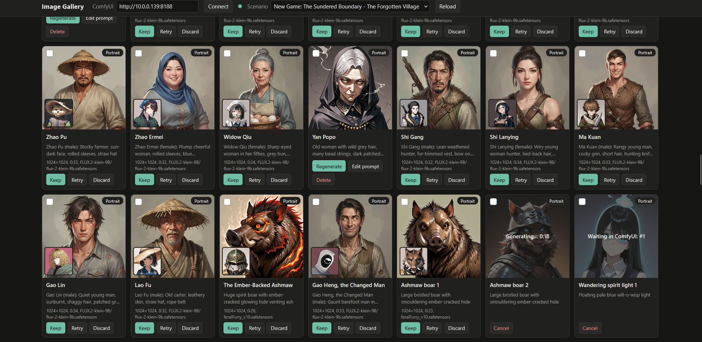
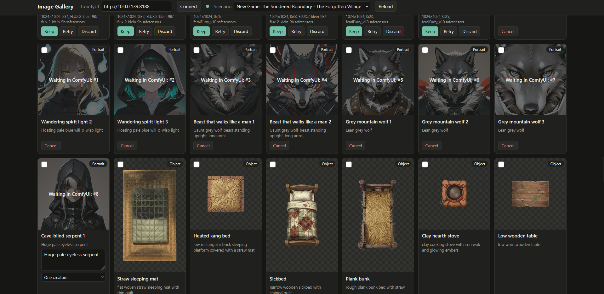
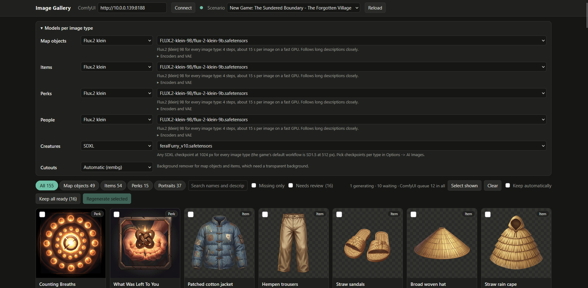

# Better Images for Anywhere RPG (ComfyUI)

Anywhere RPG's built-in ComfyUI workflow is Stable Diffusion 1.5 at 512 px, and its image prompts
are written for that model. On the newer models most people run, that gives mushy or garish map
objects and icons, and **map objects (sprites) and items keep their background**: the Official
image service removes it on its server, but the ComfyUI path never does.

These mod packs replace the workflow and prompts for each image type.

| Pack | Image types | Models | Speed |
|---|---|---|---|
| `better-images-flux2-klein` | all | Flux.2 [klein] 9B | fast (4 steps) |
| `better-images-qwen-image` | all | Qwen-Image | slow (20 steps), most literal |
| `better-images-flux1` | all | Flux.1 [dev] or [schnell] | medium (20 steps) |
| `better-images-sdxl` | all | any SDXL checkpoint, 1024 px | medium |
| `better-images-sdxl-portraits` | portraits only (add-on) | an SDXL / Illustrious checkpoint | medium |
| `better-images-sd15` | all | any SD1.5 checkpoint, 512 px | fast, small GPUs; loosest |

Each pack's `PACK-NOTES.md` lists the exact files it expects and where they go.

## Install

1. Copy one or more folders from `packs/` into the game's mods folder:
   - **Windows:** `%APPDATA%\Anywhere RPG\mods`
   - **Other systems:** open it from **Options → Mods → Open mods folder** in the game.
2. In **Options → Mods**, enable **one** main pack. To keep anime-style portraits with Flux or Qwen
   props, also enable `sdxl-portraits` **after** it.
3. In **Options → AI Images**, set the image service to ComfyUI and check the model menus:
   - With the Flux or Qwen pack they list your *diffusion models* instead of checkpoints.
   - Choose the model each image type should use.
4. Sprites and items need a background-removal node. The packs use **WAS Node Suite**'s
   `Image Rembg (Remove Background)`; install it with ComfyUI Manager.

## Your files are named differently?

The packs use the standard Comfy-Org filenames. If yours differ (subfolders, fp8/bf16 variants,
SwarmUI layouts), let the setup script read your ComfyUI and rewrite the packs:

```
python setup_image_mod.py --detect http://127.0.0.1:8188
python setup_image_mod.py --detect http://127.0.0.1:8188 --install
```

The script needs only the Python standard library. With `--detect` it only *reads* ComfyUI's model
lists; it does not queue any work.
- `--packs flux2-klein sdxl-portraits` writes only the packs you name.
- `--remover ben2|rembg|none` picks the background remover (`ben2` needs ComfyUI-RMBG).
- `--out DIR` writes the packs elsewhere.

**Why the names matter:** the game has no model menu for map objects. It uses the file named in
the sprite workflow, and if that file is missing, the first model on ComfyUI's list, which may not
even be an image model.

## Image Gallery: see and redo every image

`image_gallery.py` opens a page in your browser showing every image of a scenario or a save:
map objects, items, perks and portraits, on a checkerboard so you can see which cutouts kept
their background. Each one has **Regenerate**. The new image appears next to the old one, and you
choose **Keep**, **Retry** or **Discard**. You can also tick several and regenerate them in one go.



Each request goes straight onto ComfyUI's queue. The card shows where it is ("Waiting in ComfyUI: #3",
"Generating… 0:24") and switches to the new image when it's done; **Keep all ready** saves every
finished one at once, and **Needs review** narrows the page to just those. **Cancel** takes a waiting job off the queue or stops a running one (only
that job). Tick **Keep automatically** to save each image as soon as it finishes, without
reviewing it.



Finished results you haven't kept or discarded are picked up again from ComfyUI's history when the
page loads, even after the gallery or your browser was closed. ComfyUI forgets its history when it
restarts, so keep results before restarting ComfyUI. What you kept or discarded is noted in
`image_gallery.state.json` so it isn't offered again. Images the game generated itself are
recovered the same way when the copy on disk is older (a New Game reset wiped it, say), matched by
the description in their prompt.

**Workspaces: work outside the game.** Starting or importing a New Game replaces the game's staging
area, and with it every image you made there. To keep your work safe:

- **Copy to workspace** copies the current New Game (scenario and images) into
  `gallery-scenarios/`, where the game never touches it.
- **Open zip…** opens any scenario zip (an export, or one from this repo) as a workspace, so you
  can make its images without loading it in the game first.
- **Download zip** saves a workspace as a zip for **New Game → Import** when you're done.

**No terminal needed:** double-click the launcher for your system in this folder. It finds Python,
opens the page in your browser, and stops when you close its window.

| System | Launcher |
|---|---|
| Windows | `Start Image Gallery.bat` |
| macOS | `Start Image Gallery.command`. The first time, right-click it and choose **Open** if macOS says it can't verify it. |
| Linux | `start-image-gallery.sh` (run it, or mark it executable and double-click it) |

They need Python 3.8 or newer ([python.org](https://www.python.org/downloads/); on Windows tick
*Add python.exe to PATH*), and say so if it is missing. From a terminal it is:

```
python image_gallery.py
```



- **Models per image type:** pick a model family (Flux.2 klein, Flux.1, Qwen-Image, SDXL, SDXL
  portraits, SD1.5) and then a model from the ones your ComfyUI actually has. Encoders and VAE are
  matched for you and can be changed under *Encoders and VAE*. Your choices are kept in
  `image_gallery.settings.json`.
- **Edit prompt** changes the description for that one image only; the scenario isn't changed.
- **Portraits** get a subject: "one woman", "one man", "one girl", "one boy" or "one creature",
  read from the character's gender, age and animation, which you can override. It is worded for
  the model: booru tags (`1girl, solo` against `2girls, multiple girls`) for Illustrious, Pony
  and other anime checkpoints; plain words (`one woman, solo` against `two women, group`) for
  other SDXL and SD1.5 checkpoints; a sentence for Flux and Qwen.
- **Creatures** (characters whose animation isn't a person, such as wolves, drakes and ghosts)
  have their own row in the models panel and their own prompt: a bestiary portrait of the beast's
  real anatomy, with `anthro, humanoid, shoulders, arms, hands` in the negative and no name or
  gender in the description. The game's own portrait prompt asks for a "character portrait, head
  and shoulders", which turns monsters into person-shaped busts. Flux.2 klein handles them well
  with this prompt; for a stronger monster look, an SDXL checkpoint trained on *feral* (non-anthro)
  animals does well.
- **Keep** writes the same WebP file the game writes, deletes the shadow and outline files the
  game made from the old map-object image (it remakes them), and moves the old image to
  `gallery-backups/`. **Delete** removes an image so the game draws a new one when it next loads.
- The game reads images when it loads: **reload the scenario or save** to see the new ones.
- The page is served on `127.0.0.1:8765` only (`--port` to change, `--store` if the game's data
  folder is elsewhere). Python standard library only; save pages in Chrome, Edge or Firefox.

## How it plugs into the game

All of this is standard Anywhere RPG modding; nothing in the game's own files is changed.
- **Workflows:** the game uses `comfyui/comfyui-workflow-<kind>.json` per image type (portrait,
  sprite, item, perk).
- **Slots:** node titles containing `<input>=PROMPT|WIDTH|HEIGHT|SEED|MODEL` mark what the game
  fills in. A `UNETLoader` titled `unet_name=MODEL` makes the model menu list diffusion models.
- **Prompts:** `prompts/img_<kind>.txt` is the prompt, with `${DESC}` replaced by the description.
  **Sprites receive only the object's description, not its name.**

## Writing good descriptions for scenario authors

The generator never sees the object's name, so describe the thing in a way that can't be misread.
For example, "bed of roses" can come out as a frame of roses. "Square garden plot of dark soil
planted with pale pink rose bushes, low stone edging" works. Describe one object in one colour
scheme, with no "red or blue" choices.
