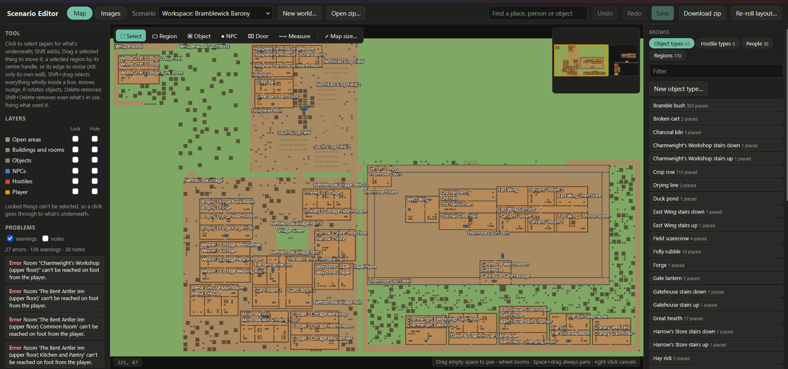
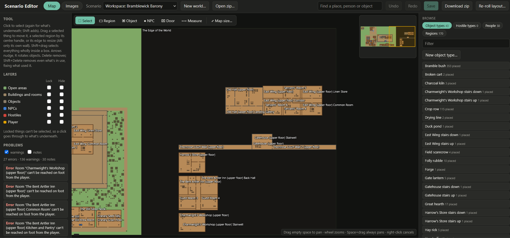
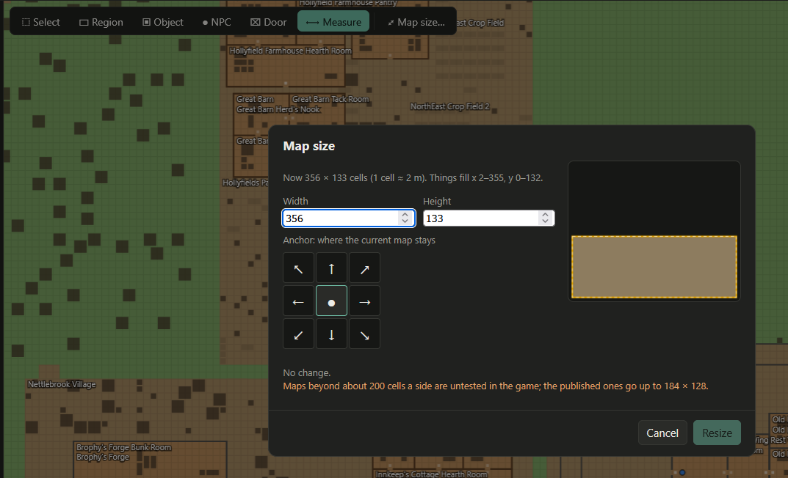
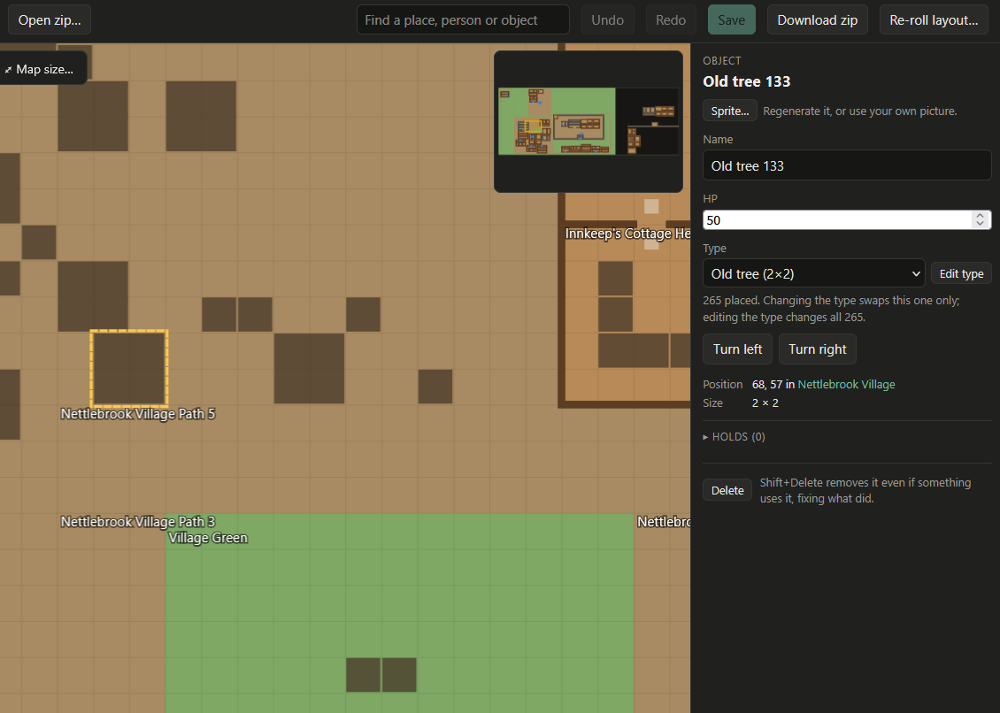
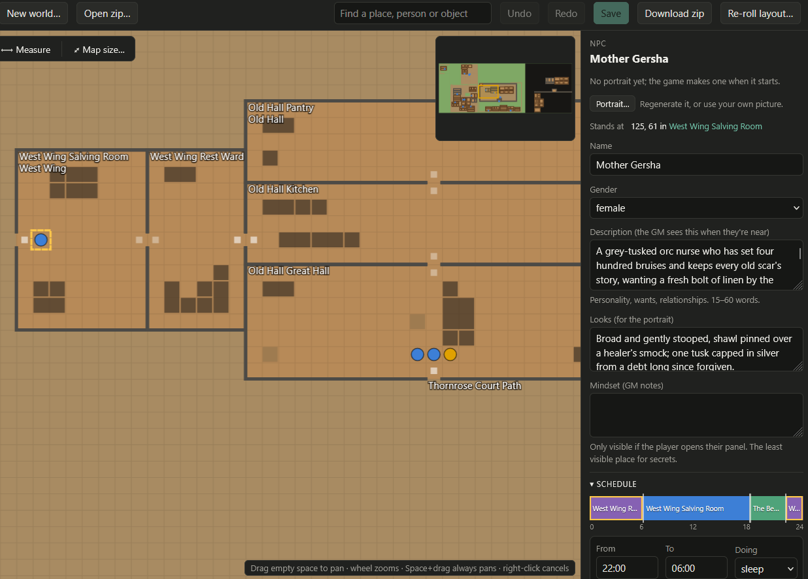

# Scenario Editor

Edit an Anywhere RPG scenario by hand after the game (or a script) has generated it — or make one
from an idea with **New world…** — then look over the map, find problems, fix names and
descriptions, and download a zip for **New Game → Import…**.

The map, the editors and the reference safety from the plan are all in. Quests, the calendar,
items and perks are still edited in the game's own New Game screen.



## Start it

Double-click the launcher for your system in this folder. It opens the editor in your browser at
`http://127.0.0.1:8766`; close the launcher's window to stop it.

| System | Launcher |
|---|---|
| Windows | `Start Scenario Editor.bat` |
| macOS | `Start Scenario Editor.command` |
| Linux | `start-scenario-editor.sh` |

It needs Python 3.8 or newer, and nothing else. From a terminal: `python scenario_editor.py`.

Built for Anywhere RPG 0.18. Its checks follow the 0.18 scenario format and map rules.

## Works with the Image Gallery

The editor runs on the [Image Gallery](../../mods/better-images)'s code and leaves the gallery itself
unchanged. The gallery still works on its own.
- **Same workspaces.** A scenario you open in one shows up in the other.
- **Images tab.** This is the gallery's own page, open on the same scenario. Regenerate images
  through ComfyUI, then keep or discard them, or **Browse…** for a picture of your own; a crop
  window sizes it and saves it as WebP.
- **Portrait…** and **Sprite…** buttons in the inspector open the Images tab showing just that
  one picture.

## Make a world (world generation)

**New world…** in the toolbar generates a whole scenario, framed before it is built: pick a
form, answer with option chips, **Frame it** (one short model call) and read the World Frame;
**Generate world** then has the model describe the world in phases (world plan, prop
catalogue, one call per building, one per zone, people in batches, then rules, perks and the
story clock) while deterministic, seeded code places everything, checks that every room is
reachable, and builds the scenario. When it finishes, the world opens here as a new workspace,
ready to edit or download. The generator is the standalone tool in
[`../world-generator`](../world-generator); the editor only drives it — it still runs on its
own from the command line.

> **Still in progress:** the layout is being improved. Generated maps can run long and wide,
> leave empty ground, and squeeze furniture. If a layout looks wrong, **Re-roll layout…** tries
> another seed for free, and a report with the run's `out/` folder helps us fix it.

The dialog's steps:

1. **Pick a form** — quick (the idea alone), or the short (7 questions), medium (14) or long
   (14, and the model asks up to five more of its own) questionnaire from the generator's
   question bank.
2. **Answer the questions** with option chips (a question may allow two picks; **Other**
   opens a text box; everything can be skipped). **Let the map decide** starts ticked, and the
   generator then sizes the population from the map, marks which buildings are in use, and
   leaves room for families. Untick it to set your own **resident count** (5–60). For more
   buildings, set a count and ask for them in step 3: see the generator's
   [Getting more buildings](../world-generator/README.md#getting-more-buildings).
3. **Other instructions or requests** (optional) takes anything the questions don't cover,
   such as a plot outline, places or people you want, or house rules. It goes word for word to
   the frame, the world plan, the people and the story phases.
4. **Frame it** runs P0 as a short job and shows the frame — its whole contract under an
   **editable summary**. In the long form the model's own questions come back first and are
   answered the same way, then **Frame it again** under them (or skip them all). Frame it
   again for another try; changing the form resets the frame.
5. **Generate world** starts the full job with the approved frame. It stays dimmed until there
   is one, and says why if you press it early.

- **Drafts.** The dialog saves itself as you go (in the generator's `out/drafts/`): the form,
  your answers, the model's questions and the frame. **Saved drafts** at the top of the dialog
  brings one back after a refresh or a closed dialog. A frame still being made when you leave
  is written into the draft when it finishes, and a running generation gets its progress
  window back when you reload the page.

- **Settings files.** **Export settings…** at the top of the dialog downloads the form as a
  small JSON file: the idea, mode, answers, other instructions, residents, seed, extensions,
  the room-library choice and, once framed, the frame. Send it to someone and they press
  **Import settings…** to get the same form back (as a new draft), frame included, so they can
  generate the same world. No provider or API key goes in it, only the model's name as a note.
  The launcher and `python -m worldgen generate --settings` read the same file, and every run
  saves one as `settings.json` in its folder under `../world-generator/out/`.

- **Your own key.** The model calls go through your own OpenAI-compatible provider (z.ai,
  OpenRouter, OpenAI, or a local Ollama / LM Studio / llama-swap), never the game's built-in
  subscription. Add one in the dialog under **Provider settings**: it is stored in the generator's
  gitignored `providers.json`, and only the last four characters of the key are ever shown again.
- **Cost and time.** A world takes **25–35 model calls, 200–320k tokens, 30–55 minutes** (the
  dialog shows the estimate before you start). On a flash-tier model that is cents on a typical
  API plan.
- **Progress and cancel.** The dialog shows the phase as it goes (the frame, world plan,
  catalogue, building n/N, zone n/N, people, systems) with a Cancel button. If a run fails, it
  shows the error and the folder holding every call's prompt and reply.
- **Use room library** — on by default: rooms are furnished from the generator's room library,
  which uses fewer tokens and sets beds, tables and chairs out properly. Untick it for the old
  method, where the model furnishes every room.
- **Extensions** — all off by default, so the plain world imports and plays in the unmodded game:

  | Extension | What it adds | Game mods needed |
  |---|---|---|
  | Floors | Upper storeys reached by stair portals | `portals`, `floors` |
  | Portals | Two-way portal pads linking two cells | `portals` |
  | Region groups | A zone may wrap around the map and still be one region | `region-groups` |
  | Lights | Each light source gets a kind (candle, hearth fire, lantern, electric, neon, screen, magic) and, where the setting calls for it, a colour | `lights` |

  Ticking Floors turns Portals on with it (its stairs are portals). The mods come from
  `../code-mod-loader`; without the ones an extension names installed in the game, a world built
  with it won't work right. Lights is the exception: without its mod, the lamps just look plain.

  With Floors, each upper storey sits in a dark band east of the play area, behind "The Edge of
  the World", which the player never reaches on foot. Stairs carry people up and down.
  The Problems panel reads the scenario's mod data: its reachability walk goes through portals
  (stairs included), a storey reached only by its stairs isn't reported as sealed, and floor
  openings count as cells nobody can walk into. A note lists the code mods a scenario's data
  needs. Region groups need no scenario data, so the panel can't tell when that mod is in use.

  
- **Re-roll layout…** appears on a workspace that came from the generator. The same world, placed
  again from its saved `plan.json` under a new seed — no model calls, a few seconds — and it opens
  as a new workspace; the old one stays untouched. A framed world keeps its frame: the plan
  carries it, so the re-roll never asks the questionnaire again.

## What it does now

- **Open** a scenario zip as a workspace (**Open zip…**), or copy the game's current New Game into
  one (**Copy to workspace**). The game's own folders are only read.
- **Map:** the regions, walls and doors as the game builds them, plus objects (with their sprites,
  turned the way they face) and people. Drag empty space to pan (or Space+drag anywhere), scroll to
  zoom, and click to select. Click again to pick the next thing underneath, and Shift+click to add
  to the selection. A minimap in the corner shows where you are; click or drag on it to go there.
- **Moving things only moves what's already selected.** Click first, then drag. A drag that starts
  on anything else pans the map, so a slip of the mouse never moves the furniture.
- **Tools** (the strip at the top of the map, or the key in brackets):
  - **Select (V):**
    - drag a selected object or person to move it;
    - drag a selected region by its round centre handle (its rooms, doors, objects and people come
      along);
    - drag a selected region's edge to resize it. Walls it shares follow: its building's wall, and
      the next room's wall, so rooms that split a building stay split. Hold Alt to move only its
      own edge.
    - Shift+drag selects everything wholly inside a box.
  - **Region (B):** name it, choose walls or none and whether it's hostile, then drag a rectangle.
  - **Object (O):** pick a type, then click to place one (click again for more). R turns it first.
  - **NPC (N):** name them and click. They start with an all-day schedule in the region they stand in.
  - **Door (D):** click a cell on a walled region's outer row or column. A door on a shared wall is
    added to both sides, the way the game's own editor does it.
  - **Measure (M):** drag to measure in cells and metres. Selecting a hostile shows its 7-cell
    aggro ring and 14-cell give-up ring.
- **Keys:**
  - arrows nudge the selection (Shift+arrow: 5 cells);
  - R and Shift+R turn objects;
  - Delete removes the selection;
  - Ctrl+C and Ctrl+V copy a region (with its rooms and objects) or objects, and paste them where
    the pointer is;
  - F centres the selection;
  - Esc cancels a drag or goes back to Select, and so does a right-click.
- **Map size…** (at the end of the tool strip) grows or shrinks the map. Set the width and height,
  and pick an anchor on the 3 × 3 grid: the side or corner the current map stays against, as in
  an image editor's canvas resize. New cells go on the other sides, and everything moves with the
  map, doors included. A preview shows the old map inside the new one. A size that would cut
  anything off is refused, naming what.

  
- **Nothing breaks the map.** A move, resize, new region or paste that would leave two regions
  partly overlapping is refused, and so is anything that would leave the map.
- **Delete is safe.** Delete removes what nothing uses. Something in use opens a dialog that
  previews exactly what will change; **Shift+Delete** opens it straight away. Confirming deletes
  it, and repairs everything that used it with the smallest change that keeps it working:
  - a schedule block at a deleted region is removed, and the block before takes over its time. The
    person stays; you can choose to move those blocks to another region instead.
  - calendar events there become "anywhere";
  - hostile types that live there move to the replacement region (its parent, unless you pick
    another);
  - deleting an object type deletes its placed copies, which can't exist without it, and only the
    effect entries that spawn it;
  - deleting an item removes only the stacks, equipment, loot entries and effect entries that hold
    it.

  Rooms and objects inside a deleted region stay unless you tick "also delete". People are never
  deleted that way, and the player can't be deleted at all. Every inspector has a Delete button too.
- **Rename everywhere.** Renaming a region, person, object, type or item updates every place that
  names it: schedules and calendar events for regions, effect entries for items. Then, if the old
  name still appears as a whole word in free text (descriptions, mindsets, memories, quests, rules,
  the world background), a dialog lists each one in context to tick and replace. Words that only
  contain it, like "Millie" for "Mill", aren't listed.
- **Download zip** warns first if the Problems panel lists errors.
- **Layers:** lock a layer so clicks go through it, or hide it.
- **Problems:** the scenario is checked after every change (`scenario_checks.py`). Click a problem
  to jump to it. One check counts people by the hour: more than 8 awake in a walled room (or per
  14-cell circle of open ground) gets a warning, because the GM reads everyone in a room in full
  every turn. A room that only sleeps that many gets a note.
- **Inspector:** the right-hand panel edits whatever you selected. Every field change is one undo
  step.
  - **Nothing selected:** browse object types, hostile types, people and regions by name. You can
    also make a new object type here.
  - **Region:**
    - name, description, walls (or none), hostile, ground, texture, tints and day and night
      ambience;
    - its doors, each removable along with its matching other side;
    - beds against the people who sleep there (a 2×2 or larger bed sleeps two);
    - **who is here when:** a 24-hour strip of everyone whose schedule brings them here, by role.
      Click an hour to list them.
  - **Object:**
    - name, HP, and what it holds;
    - turn it, or change its type.
    - **Edit type** opens the object type, where changes apply to every one placed: size,
      movement, bed, crafting, light, height, HP, money tier, tags and loot.

    
  - **Person:**
    - name, gender, description, looks, mindset, sprite and colour, level, money, hostility and
      stance, and voice;
    - what they carry, wear and sell, and what they remember;
    - their schedule: a 24-hour bar where you drag the line between two blocks to change the
      time (in 15-minute steps), and click a block to change where they are and what they're
      doing, split it or remove it.

    
  - **Hostile type:** where they spawn, how many, sprite, level and loot.
  - Every inspector lists what uses the selected thing, each item clickable.
- **Rename a region:** every schedule and calendar event that names it is updated as well.
- **Undo and redo** (Ctrl+Z, Ctrl+Y), with a whole drag as one step. **Save** (Ctrl+S) and
  **Download zip**. Each save first backs up the previous `scenario.json` to
  `mods/better-images/gallery-backups/`.

## Tests

```
node --test
python -m unittest discover -s test -p "test_*.py"
```

Run these from this folder. The node tests cover the map operations (`mapops.js`), schedules
(`schedule.js`), references (`refs.js`) and the minimap's coordinate helpers (Node 18 or newer).
The python tests cover the world generation endpoints against a mocked generator (no model calls),
and the checks' handling of code-mod data (portals, floors) and bed capacity;
the generator's own suite runs from `../world-generator` with `python -m unittest`.

## Checks on their own

```
python scenario_checks.py My-Scenario.scenario.zip
```

This checks a zip, a folder or a `scenario.json` against the rules the game actually uses. The exit
code is 1 if there are errors.
